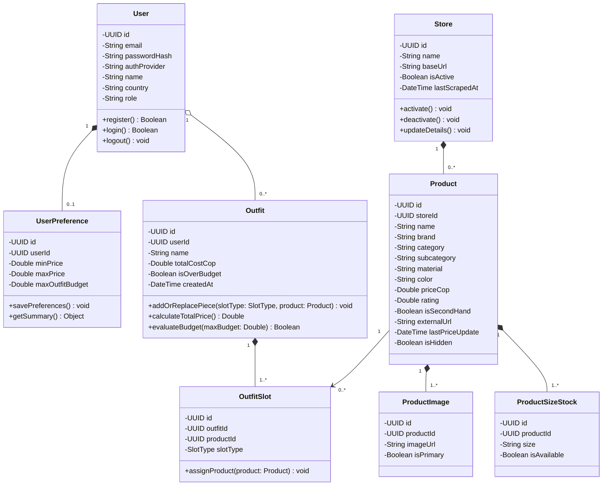
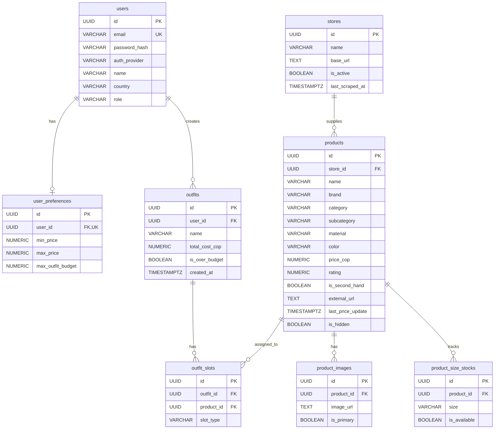

# Design & Data Model — Outfit Builder (MVP / Release 1)

## 1. MVP System Boundaries & Business Rules

The MVP is a lightweight web application that aggregates clothing products from supported online stores into a unified catalog, allows users to search, filter, compare prices in Colombian Pesos (COP), assemble 3-piece outfits (`top`, `bottom`, `shoes`) within a personal budget, save outfits by name, and redirect to the original stores to purchase each item.

### Core Business Rules (MVP)
* **BR-01 (Store Management):** Only stores configured and activated by an Administrator provide products to the catalog.
* **BR-02 (Data Standardization):** Products collected from different stores must be transformed into a common structure (standardized category, color, size, price in COP, images, stock per size, and external URL).
* **BR-03 (COP Currency):** All prices must be stored and displayed in Colombian Pesos (`COP`) as non-negative numeric values (`NUMERIC(12,2)`).
* **BR-05 (User Budget):** Users can set a `max_outfit_budget`. When an outfit's total cost exceeds it, `is_over_budget` is set to `true` as a **non-blocking warning** (users can still edit and save the outfit).
* **BR-06 (Price Range):** Users can set `min_price` and `max_price` (`min_price <= max_price`).
* **BR-07 (Filtering & Sorting):** Filtering by price, brand, color, available size, category/subcategory, and store; sorting by price. Missing attributes must not be treated as confirmed matches.
* **BR-08 & BR-09 (Outfit Composition & Total):** An outfit consists of three slots: `top`, `bottom`, and `shoes`. Each slot holds one optional product reference. Total cost is the sum of assigned products' `price_cop`, recalculated immediately on every add or replace.
* **BR-10 (External Purchases):** Purchases happen exclusively on the external retailer's website via `external_url`.
* **BR-12 (Source Isolation):** Scraping failures on one store must never block catalog search or outfit building.
* **BR-13 (Restricted Content):** Sexually explicit or restricted adult-oriented merchandise must be filtered out during ingestion/standardization without excluding normal adult clothing.
* **BR-14 (Second-Hand Flag):** Second-hand garments must be explicitly marked via `is_second_hand = true`.
* **BR-16 (Access Control):** Users can only read/write their own preferences and saved outfits. Store management and scraping triggers are restricted strictly to `role = 'admin'`.

---

## 2. MVP Domain Entities (8 Classes)

| Class | Purpose |
| --- | --- |
| `User` | Registered user (`user` or `admin`) authenticated via email and password hash. |
| `UserPreference` | User's preferred product price range (`minPrice`, `maxPrice`) and `maxOutfitBudget` in COP. |
| `Store` | External clothing retailer managed by an administrator. |
| `Product` | Standardized clothing item collected from a store, priced in COP. |
| `ProductImage` | Image belonging to a product's gallery (`isPrimary` flag). |
| `ProductSizeStock` | Stock availability for a specific size of a product. |
| `Outfit` | User-created combination of pieces with calculated `totalCostCop` and `isOverBudget` status. |
| `OutfitSlot` | One position (`top`, `bottom`, `shoes`) inside an outfit holding an optional product. |

---

## 3. MVP UML Class Diagram

---

## 4. MVP Relational Database Model (PostgreSQL — 8 Tables)

### Entity-Relationship Diagram

### Table Definitions

#### 1. `users`
| Column | Type | Constraints |
| --- | --- | --- |
| `id` | `UUID` | `PRIMARY KEY` |
| `email` | `VARCHAR(255)` | `NOT NULL, UNIQUE` |
| `password_hash` | `VARCHAR(255)` | `NOT NULL` |
| `auth_provider` | `VARCHAR(30)` | `NOT NULL DEFAULT 'local'` |
| `name` | `VARCHAR(150)` | `NOT NULL` |
| `country` | `VARCHAR(100)` | `NULL` |
| `role` | `VARCHAR(30)` | `NOT NULL DEFAULT 'user' CHECK (role IN ('user', 'admin'))` |

#### 2. `user_preferences`
| Column | Type | Constraints |
| --- | --- | --- |
| `id` | `UUID` | `PRIMARY KEY` |
| `user_id` | `UUID` | `NOT NULL, UNIQUE, REFERENCES users(id) ON DELETE CASCADE` |
| `min_price` | `NUMERIC(12,2)` | `NULL CHECK (min_price >= 0)` |
| `max_price` | `NUMERIC(12,2)` | `NULL CHECK (max_price >= 0)` |
| `max_outfit_budget` | `NUMERIC(12,2)` | `NULL CHECK (max_outfit_budget >= 0)` |
| *Table Check* | — | `CHECK (min_price IS NULL OR max_price IS NULL OR min_price <= max_price)` |

#### 3. `stores`
| Column | Type | Constraints |
| --- | --- | --- |
| `id` | `UUID` | `PRIMARY KEY` |
| `name` | `VARCHAR(150)` | `NOT NULL` |
| `base_url` | `TEXT` | `NOT NULL` |
| `is_active` | `BOOLEAN` | `NOT NULL DEFAULT TRUE` |
| `last_scraped_at` | `TIMESTAMPTZ` | `NULL` |

#### 4. `products`
| Column | Type | Constraints |
| --- | --- | --- |
| `id` | `UUID` | `PRIMARY KEY` |
| `store_id` | `UUID` | `NOT NULL, REFERENCES stores(id) ON DELETE CASCADE` |
| `name` | `VARCHAR(255)` | `NOT NULL` |
| `brand` | `VARCHAR(150)` | `NULL` |
| `category` | `VARCHAR(100)` | `NOT NULL` (`top`, `bottom`, `shoes`) |
| `subcategory` | `VARCHAR(100)` | `NULL` |
| `material` | `VARCHAR(150)` | `NULL` |
| `color` | `VARCHAR(100)` | `NULL` |
| `price_cop` | `NUMERIC(12,2)` | `NOT NULL CHECK (price_cop >= 0)` |
| `rating` | `NUMERIC(3,2)` | `NULL CHECK (rating >= 0 AND rating <= 5)` |
| `is_second_hand` | `BOOLEAN` | `NOT NULL DEFAULT FALSE` |
| `external_url` | `TEXT` | `NOT NULL` |
| `last_price_update` | `TIMESTAMPTZ` | `NULL` |
| `is_hidden` | `BOOLEAN` | `NOT NULL DEFAULT FALSE` |

#### 5. `product_images`
| Column | Type | Constraints |
| --- | --- | --- |
| `id` | `UUID` | `PRIMARY KEY` |
| `product_id` | `UUID` | `NOT NULL, REFERENCES products(id) ON DELETE CASCADE` |
| `image_url` | `TEXT` | `NOT NULL` |
| `is_primary` | `BOOLEAN` | `NOT NULL DEFAULT FALSE` |

#### 6. `product_size_stocks`
| Column | Type | Constraints |
| --- | --- | --- |
| `id` | `UUID` | `PRIMARY KEY` |
| `product_id` | `UUID` | `NOT NULL, REFERENCES products(id) ON DELETE CASCADE` |
| `size` | `VARCHAR(30)` | `NOT NULL` |
| `is_available` | `BOOLEAN` | `NOT NULL DEFAULT TRUE` |
| *Table Constraint* | — | `UNIQUE (product_id, size)` |

#### 7. `outfits`
| Column | Type | Constraints |
| --- | --- | --- |
| `id` | `UUID` | `PRIMARY KEY` |
| `user_id` | `UUID` | `NOT NULL, REFERENCES users(id) ON DELETE CASCADE` |
| `name` | `VARCHAR(150)` | `NOT NULL` |
| `total_cost_cop` | `NUMERIC(12,2)` | `NOT NULL DEFAULT 0 CHECK (total_cost_cop >= 0)` |
| `is_over_budget` | `BOOLEAN` | `NOT NULL DEFAULT FALSE` |
| `created_at` | `TIMESTAMPTZ` | `NOT NULL DEFAULT NOW()` |

#### 8. `outfit_slots`
| Column | Type | Constraints |
| --- | --- | --- |
| `id` | `UUID` | `PRIMARY KEY` |
| `outfit_id` | `UUID` | `NOT NULL, REFERENCES outfits(id) ON DELETE CASCADE` |
| `product_id` | `UUID` | `NULL, REFERENCES products(id) ON DELETE SET NULL` |
| `slot_type` | `VARCHAR(60)` | `NOT NULL CHECK (slot_type IN ('top', 'bottom', 'shoes'))` |
| *Table Constraint* | — | `UNIQUE (outfit_id, slot_type)` |

---

### Tables Explicitly Excluded from MVP
`user_preference_brands`, `user_preference_colors`, `user_preference_fits`, `favorite_products`, `product_reports`, `outfit_collections`, `outfit_collection_items`, `scraping_logs`.